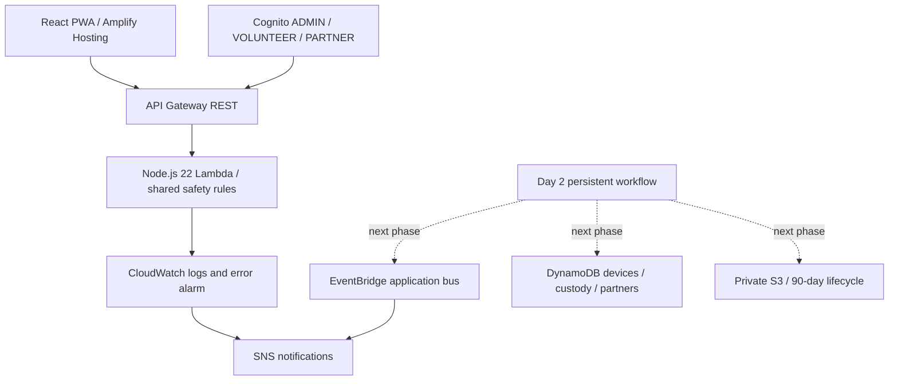

# RebootRoute

Repair first. Recycle right. A campus e-waste assessment and custody application for phones, laptops, and power banks, built for the Waste & Energy track.

## Working now — Day 1

- React/TypeScript/Vite intake with category-specific questions, optional compressed photo previews, consent, and accessible controls.
- Shared, deterministic safety rules: Safety Review → eligible Reuse → bounded Repair → Recycle; uncertain/conflicting evidence leads to Manual Review. Power-bank repair is never offered.
- Explained outcomes with next steps, limitations, confidence bands, and versioned rules. AI is not needed or enabled.
- Lambda health, assessment-preview, and Cognito-authorized session endpoints. Configuring `VITE_API_BASE_URL` makes the frontend use the deployed preview API; network failures fall back to the same local rules.
- SAM infrastructure for the AWS backend, private S3, DynamoDB tables, Cognito groups, EventBridge/SNS, and CloudWatch monitoring; Amplify build configuration.

**This is an assessment preview, not a completed MVP.** Photos stay in memory in the browser tab. Assessments are not saved. Guest sessions, uploads, QR receipts, custody, admin dashboard/login UI, privacy declarations, and deployment acceptance tests are the next phases in [plan.md](plan.md). The web manifest is present; offline caching/installability work remains.

## Run locally

Node.js 22.12+ is required.

```sh
npm ci
npm run dev
```

Open the URL Vite prints (normally `http://127.0.0.1:5173`). No AWS account, card, keys, AI provider, or Docker is needed for the local assessment. Leave `VITE_API_BASE_URL` empty. If needed, copy `.env.example` to `.env` before changing public configuration.

## Verify

```sh
npm test
npm run build
npm run build:backend
```

`npm run check` runs all three. Tests cover baseline outcomes, each safety flag/category, uncertain/contradictory inputs, consent, category validation, every power-bank answer combination, Lambda input/role boundaries, and network fallback including remote safety downgrades. They do not prove technician-level safety or a deployed end-to-end custody flow.

With AWS SAM installed:

```sh
sam validate --lint --region ap-south-1
PATH="$PWD/node_modules/.bin:$PATH" sam build
sam local start-api --port 3001
```

SAM local API execution requires Docker. `POST /assessments/preview` accepts the schema in `shared/assessment.ts`; `GET /health` reports version and preview capabilities. SAM local does not reproduce Cognito token validation or create DynamoDB/S3 resources. Do not treat it as an auth/security integration test.

## Configure and deploy AWS

Follow [docs/aws-setup.md](docs/aws-setup.md) for account plan/credits, MFA, budget alerts, temporary CLI login, SAM build/deploy, and Amplify configuration. All app resources use the PRD's stack; target region is Mumbai (`ap-south-1`). No deployment has been performed by this implementation.



## Safety and privacy

Safety flags override ordinary outcomes. AI output will remain advisory and require human confirmation. The current manual flow does not infer damage from images, verify internal battery health, or certify electrical safety. Data-removal instructions are for owners; this app does not wipe devices or certify destruction. Outcomes are candidates subject to qualified human review, not final diagnoses. No speculative carbon or cost savings are shown.

Public receipts must expose no contact details, raw serials, or photos. Private photo retention is 90 days; custody events are retained one year. Optional contact information will require separate expiry/removal at handover + 30 days in the persistent phase; expiring a whole device record would destroy the custody record and is not a substitute. Do not collect contact details in the current preview.

See [prd.md](prd.md) for product requirements and [progress.md](progress.md) for verified milestones. No credentials belong in source control. `.env`, SAM deployment configuration, build outputs, and local AWS outputs are gitignored.
